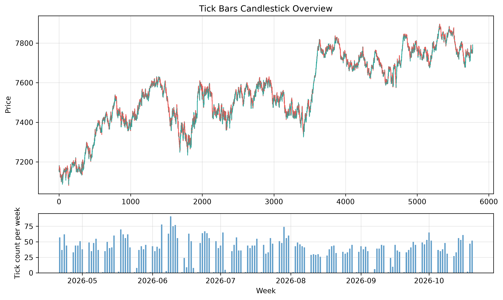
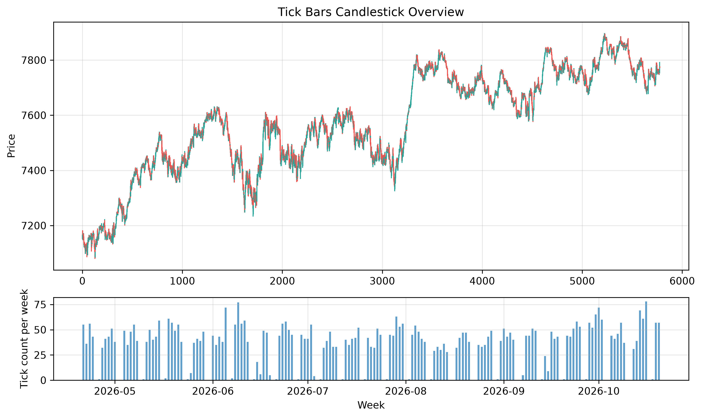
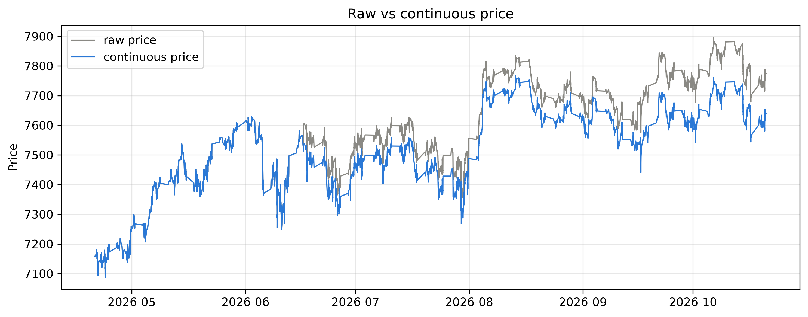
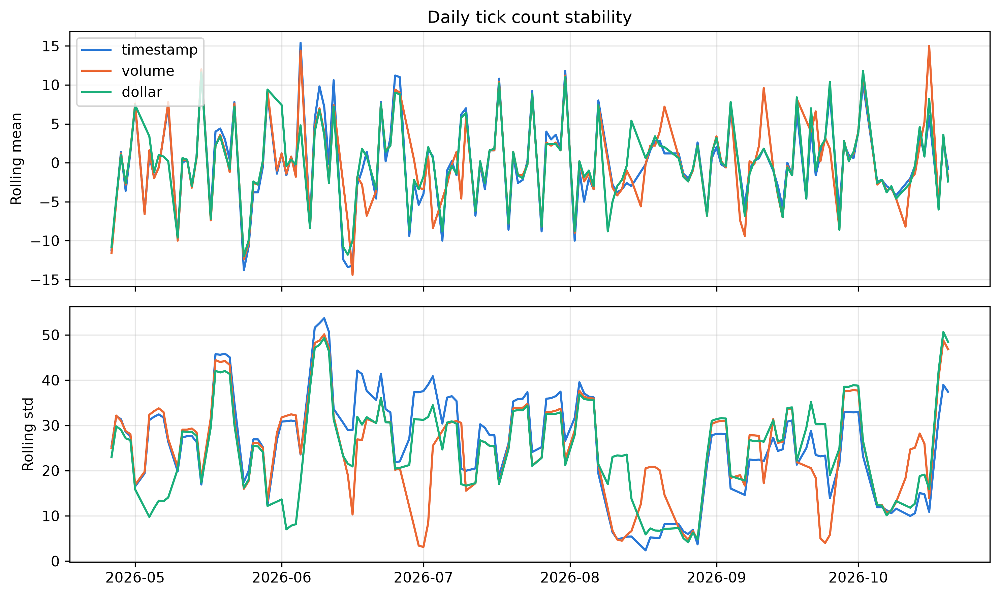
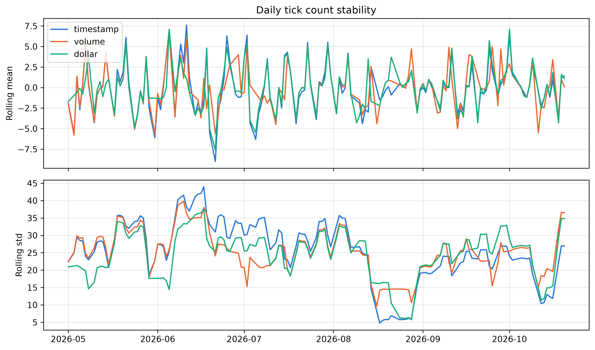
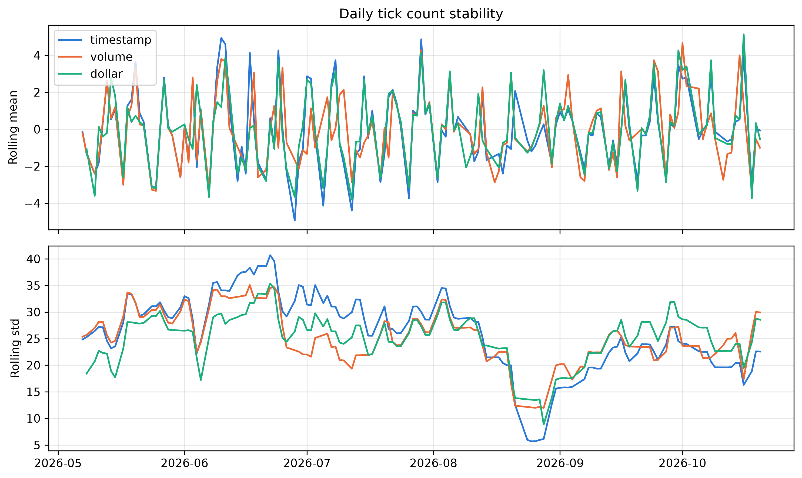
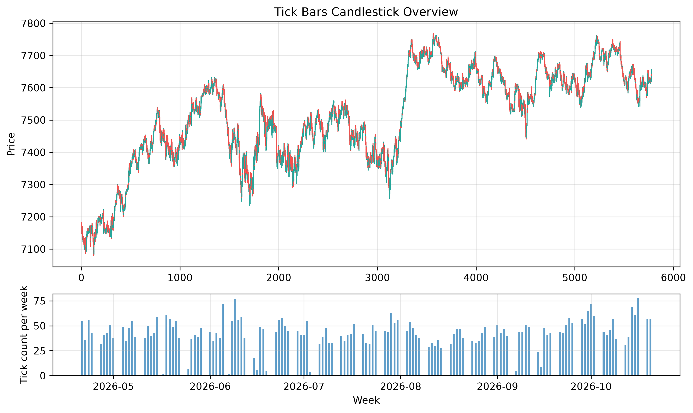
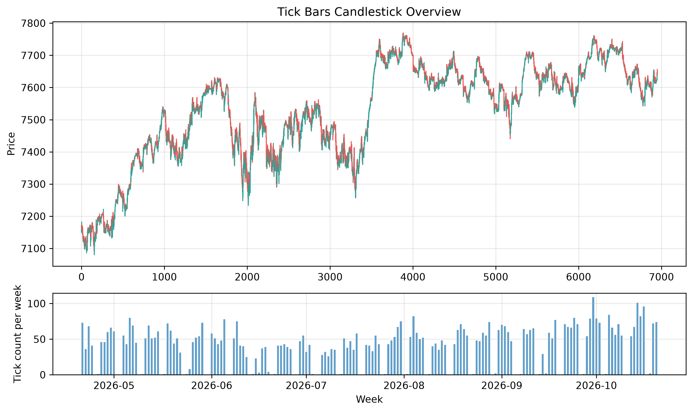

## Ticks

### Used data - E-mini S&P 500

To better understand the tick system, I have decided to fetch the E-mini S&P 500 data from Databento. The fetched data has many fields, and this is what I understand all of those fields mean:

- `ts_recv` - timestamp in UTC when Databento received the trade message. A trade message describes the actual execution of a trade at the moment an exchange's matching engine makes a match. It is a permanent record of the transaction being committed. While limit orders represent the intention to sell or buy at a given price, a trade message represents an actually executed transaction.

- `ts_event` - timestamp in UTC when the matching engine of the CME (the Chicago Mercantile Exchange, the world's largest and most dominant financial derivatives exchange) executed the trade.

- `rtype` - a record type. Because Databento can store multiple types of data, it basically tells the parser which kind of record to expect. We can have:
  - **MBO (Market By Order)** - a single order book event. The row represents a specific trader adding, modifying, or canceling an individual limit order in the queue.

  - **MBP-1 / MBP-10 (Market By Price)** - an update to the aggregated order book. The row shows the total volume resting at the best price level (MBP-1) or the top 10 price levels (MBP-10).

  - **Trade** - a completed transaction. The row represents a matched buy and sell, as discussed previously.

  - **OHLCV (Open, High, Low, Close, Volume)** - time-aggregated summary bars (e.g., a 1-second, 1-minute, or daily summary of price action).

- `publisher_id` - the ID of the publisher. Because we deal with the S&P 500, the publisher is always CME Globex.

- `instrument_id` - the ID of the instrument being traded. It is not constant even though we analyse a single symbol, the E-mini S&P 500. This happens because of the contract expiration date, which forces the index to roll over to the new instrument, therefore changing the ID. The E-mini was introduced because the value of the original contract was too high, and a change of one tick made a big difference. The E-mini is worth one-fifth of what the "original" contract was worth. The original S&P 500 contract was discontinued.

- `action` - because we fetched trade data, it will always be `T` (trade).

- `side` - a categorical feature. **B** - the buyer hit the ask, **A** - the seller hit the bid, **N** - unknown.

- `depth` - the book level the trade happened at (always 0 for trades). When an order is bigger than what is available at the current price, it is split into suborders, each matched at depth 0 until the contract is fulfilled.

- `price` - the trade price in index points (1 point = \$50 per contract). For the S&P 500 data, the value always moves in 0.25 increments and each point is worth \$50 (so the 0.25 increment is worth \$12.50). This does not apply to individual stocks. Commonly listed stocks priced over \$1.00 can only move in \$0.01 increments (governed by the SEC Reg NMS, Rule 612). This is the tick size for individual stocks: the price cannot move in smaller increments. So how is the connection to the actual S&P 500 companies made? It is made using a mathematical expiration rule and algorithmic arbitrage. The first thing is the actual calculation of the S&P 500. It is a market-capitalization-weighted average of 500 large US companies. It is represented by:

  $$
      \text{Index} = \frac{1}{D}\sum_{i=1}^{500} P_i Q_i,
  $$

  where:
  - $P_i$ - the price of the $i$-th company,
  - $Q_i$ - the number of publicly tradable shares of the company,
  - $D$ - a proprietary number maintained by S&P Dow Jones Indices (currently in the billions). It scales the multi-trillion-dollar market cap sum down to a readable reporting level.

  A computer continuously calculates these 500 changing market caps and outputs the spot value of the S&P 500 Index. Futures contracts have an expiration date (for ES, the official ticker of the E-mini S&P 500, this is the third Friday of the contract month). The S&P 500 future contract is **cash-settled**, which means that at the exact moment of the contract's expiration, it is instantly converted to cash based on the current calculated value of the S&P 500 index. Because of this, it trades extremely close to the actual price of the index. The other thing keeping the price of the S&P 500 index very close to the actual trading value of the underlying companies is HFT arbitrage. If the index is undervalued, automated algorithms will sell their shares of the listed companies, driving their prices down, and buy the index, which gives them a profit. The mirrored situation happens when the stock is overvalued. There is a small spread relative to the S&P 500 value: it trades at a slight premium. This gap is called **fair value**. Because a future is an agreement to buy later, holding the future is mathematically equivalent to holding your cash in a bank account (earning interest) minus the stock dividends you miss out on by not owning the actual shares.

- `size` - how many contracts were traded. The actual value of the traded asset is size $\times$ price $\times$ \$50.

- `flags` - some additional information about the packets.

- `ts_in_delta` - tells us how long before `ts_recv` CME sent the message, so it leaves out the time inside the matching engine.

- `sequence` - CME's message sequence number.

- `symbol` - the identifier of the traded symbol. Here it is constant and equal to `ES.v.0`.

Okay, I think we now know what the data is about. We can move on to analysing the ticks and processing the data.

### Creating tick plots

Let's jump into the code that can be used to generate various kinds of tick data. Given the data described above, we first need to load it and do some initial filtering. We can use Polars' lazy scanning and processing to first construct the execution graph of the operations and then eagerly execute all the optimized operations. Loading and filtering can be performed using:

```python
columns = ["ts_recv", "price", "size"]
data_path = Path(__file__).parent.parent / "data" / "ES-trades-2026-04-21_2026-10-21.parquet"
df = (
    pl.scan_parquet(data_path)
    .select(columns)
    .with_row_index()
)
```

The rows are indexed (this will come in handy later). Let's create a dataframe holding the actual tick data:

```python
timestamp_bin_size = 10000
ticks = (
    df.lazy()
    # quantizing the ticks into bins
    .with_columns(
        bin=(pl.col("index") // timestamp_bin_size)
    )
    # grouping by index
    .group_by("bin")
    # aggregating the most useful values (OHLCV)
    .agg(
        ts_datetime=pl.from_epoch(pl.col("ts_recv"), time_unit="ns").first(),
        open=pl.col("price").first(),
        high=pl.col("price").max(),
        low=pl.col("price").min(),
        close=pl.col("price").last(),
        volume=pl.col("size").sum(),
    )
    # sort by timestamp again
    .sort("ts_datetime")
)
```

This code produces a dataframe that stores, in each row, the OHLCV data we are interested in. To see how different tick types evolve over the weeks, we can also aggregate how many ticks were produced each week.

```python
daily_ticks = (
    ticks
    .group_by_dynamic("ts_datetime", every=agg_bin_size)
    .agg(
        tick_count=pl.len()
    )
)
```

After feeding it through a simple plotting function, we get this plot:



By changing the preprocessing a little, we can get volume bars and dollar bars. To get volume bars, we need to calculate the average trade size (to normalise the bin size, so that the timestamp ticks and volume ticks operate on the same bin scale), calculate the cumulative sum of the trade sizes, and group using bins derived from those values. Further processing is exactly the same as for timestamp ticks.

```python
volume_bin_size = (
    df.select(pl.col("size").mean())
    .collect()
    .item()
) * timestamp_bin_size

ticks = (
    df.lazy()
    .with_columns(
        cum_volume=pl.col("size").cum_sum()
    )
    .with_columns(
        bin=(pl.col("cum_volume") // volume_bin_size)
    )
    ...
)
```

This produces:


By doing slightly different processing, we get dollar ticks.

```python
stock_value = 50.0
dollar_bin_size = (
    df.select(
        (pl.col("price") * pl.col("size") * stock_value).mean()
    )
    .collect()
    .item()
) * timestamp_bin_size

ticks = (
    df.lazy()
    .with_columns(
        cum_dollar=(pl.col("size") * pl.col("price") * stock_value).cum_sum()
    )
    .with_columns(
        bin=(pl.col("cum_dollar") // dollar_bin_size)
    )
    ...
)
```

This produces:



### Solving the rollover problem

Because futures expire and investors don't want to settle them in cash, a rollover is performed. This is done with a **Calendar Trade**, which executes two actions in one single command: it sells the old instrument and buys the new one. This approach guarantees a consistent price across the rollover. Because the instrument changes, there can be (and often is) a discrepancy between the prices of those two instruments. Standard backward adjustment (the "Panama Canal" method) subtracts the roll gap from historical prices, which eventually drives historical prices below zero, destroying the ability to calculate percentage or log returns. The ETF Trick solves this by simulating an actual portfolio (like an ETF) that holds the active contract. Instead of adjusting past prices, it continually accumulates the true realized Profit & Loss (P&L) of the currently held asset, starting from a base value of \$100.00 (or any starting capital).

We can simulate this process as follows. Let $K_0 = \$100.00$ be the price of the simulated asset. The price of this asset is driven only by the difference in price between the **active** contracts. If no roll occurred between timestamps $t-1$ and $t$, we set:

$$
    \Delta P_t = P_t - P_{t-1}.
$$

If a roll occurred:

$$
    \Delta P_t = 0.
$$

Your new, mathematically pure continuous price is simply the cumulative sum of those true price changes added to your starting base:

$$
    K_t = K_0 + \sum_{i=1}^{t} \Delta P_i
$$

Let's implement the solution to the rollover problem in Polars. The first thing is preparing an additional column for the continuous price, as defined above. It will be added to the `df` dataframe and carried through the computation.

```python
clean = (
    df.lazy()
    .with_columns(
        # diff creates a column of deltas between the
        # (i-1)-th and i-th rows. Null in row 0
        price_diff=pl.col("price").diff()
    )
    .with_columns(
        # when the instrument rolls over, it's 0
        # when not, it's delta P
        true_pnl=(
            pl.when(pl.col("instrument_id") != pl.col("instrument_id").shift(1))
            .then(0.0)
            .otherwise(pl.col("price_diff"))
        )
    )
    .with_columns(
        # take care of the null value, cumsum and add the starting price
        continous_price=(
            pl.col("true_pnl").fill_null(0.0).cum_sum() + starting_base
        )
    )
    # drop useless columns
    .drop(["price_diff", "true_pnl"])
)
```

Now we have the additional field `continous_price` in the dataframe. We can pull it into the `agg` step when creating ticks, like this:

```python
.agg(
    ...,
    continuous_close=pl.col("continous_price").last(),
    continuous_open=pl.col("continous_price").first(),
    ...
)
```

By creating another simple plotting function and visualizing the `price` vs. `continous_price` closing prices, we see:



### Assessing the stability of tick plots

Because I have fetched only 6 months of data, I have decided to plot the daily bar counts and then assess the stability of the tick plots. The first idea is to take the `diff()` of the tick count column and calculate its mean and std. This would be the wrong approach, because calculating one common mean and std masks the small movements of the market. Analysing the overall mean of the deltas will only give us the overall trend in the market and won't provide any information about local variability. The same goes for the standard deviation. That's why we use and plot rolling metrics. In these examples, I plotted the values with window sizes $\in \{5, 10, 15\}$. Of course, the longer the window, the more smoothing will be present on the graph. The code that calculates the rolling metrics looks like this:

```python
for window_size in [5, 10, 15]:
    metrics = (
        daily_tick_count.lazy()
        # calculate the deltas, take care of the first null
        .with_columns(
            deltas=pl.col("tick_count").diff().fill_null(0.0)
        )
        # create the rolling metrics
        .with_columns(
            rolling_mean=pl.col("deltas").rolling_mean(window_size=window_size),
            rolling_stds=pl.col("deltas").rolling_std(window_size=window_size),
        )
        .collect()
    )
    plot(metrics, ...)
```

This yields:







I think the dollar plots look pretty good, maybe better than the rest. This might be because a given set of investors operates with a constant amount of capital in the instrument. And because that capital is defined in USD, it should stay fairly constant throughout the entire period.

### Assessing the correlations

First, we need to define what returns are. Let's distinguish three types:

- Simple dollar return. Given the price of an asset at times $t-1$ and $t$, we calculate a delta:

  $$
      R_t = P_t - P_{t-1}.
  $$

- Percentage returns. This is the most commonly used way of describing returns. It is calculated using:

  $$
      R_t = \frac{P_t - P_{t-1}}{P_{t-1}}.
  $$

  It is easily interpretable for humans, but it is a skewed data type. Imagine that the stock price drops 50%: it then has to go back up 100% to make up for the drop. This means that the returns don't add up to 0 over a period in which the start and end prices are equal.

- Log returns. They make the returns perfectly interpretable for ML models. They are described using:

  $$
      R_t = \ln \left(\frac{P_t}{P_{t - 1}} \right) = \ln P_t - \ln P_{t - 1}.
  $$

  We can simply add log returns together across time to calculate total returns over a week or a month. ML algorithms require stationary data (constant mean and variance over time). Converting an exponentially growing price series into log returns flattens it into a stable, stationary series that algorithms can actually interpret.

Okay, back to the topic of return correlation. We can interpret **serial correlation** (or autocorrelation) as a statistical measure of how strongly a variable's current value is related to its past values at a specific time lag. Basically, it describes momentum over time. A positive correlation signals that a rising stock price will likely be followed by another rise.

The serial correlation (autocorrelation - ACF) of returns $R$ at a given lag $k$ is calculated using the Pearson correlation formula against its own lagged series:

$$
    r_k = \frac{\sum_{t=k+1}^{T} (R_t - \bar{R})(R_{t-k} - \bar{R})}{\sum_{t=1}^{T} (R_t - \bar{R})^2},
$$

where:

- $R_t$ is the return at time $t$,
- $R_{t - k}$ is the return shifted $k$ steps backward,
- $\bar{R}$ is the mean return.

Implementing this formula in Polars gives:

```python
for lag in [1, 5, 10, 15, 20]:
    corr = (
        df.lazy()
        # create the log return column by shifting, dividing and taking a log
        .with_columns(
            log_return=(pl.col("close") / pl.col("close").shift(1)).log()
        )
        # create the lagged return column
        .with_columns(
            lagged_return=pl.col("log_return").shift(lag)
        )
        # use the built-in pl.corr method to calculate the correlation between the columns
        .select(
            serial_corr=pl.corr("log_return", "lagged_return", method="pearson")
        )
        .collect()
        # cast to a single number
        .select("serial_corr")
        .item()
    )
```

Running the code and printing the results gives:

```
Lag value k = 1
        Timestamp serial correlation: -0.0018
        Volume serial correlation:    -0.0067
        Dollar serial correlation:    -0.0069
Lag value k = 5
        Timestamp serial correlation: 0.0126
        Volume serial correlation:    -0.0213
        Dollar serial correlation:    -0.0020
Lag value k = 10
        Timestamp serial correlation: -0.0120
        Volume serial correlation:    0.0021
        Dollar serial correlation:    0.0063
Lag value k = 15
        Timestamp serial correlation: -0.0049
        Volume serial correlation:    -0.0064
        Dollar serial correlation:    0.0060
Lag value k = 20
        Timestamp serial correlation: -0.0045
        Volume serial correlation:    0.0144
        Dollar serial correlation:    0.0108
```

I feel like the dollar correlations are the smallest, or at least have the smallest variability across the different lag values.

### Checking the "normality" of the returns distribution

We can run a Jarque-Bera test on the returns to check whether they behave like a normal distribution. To do that, we need to calculate two metrics of our returns: skewness and kurtosis. The normal distribution has skewness equal to $0$ and kurtosis equal to $3$. If the distribution deviates from normal, the score will move further from $0$. A quick refresher on how to calculate those values:

Skewness:

$$
    \text{S} = \mathbb{E} \left[ \left( \frac{X - \mu}{\sigma} \right)^3 \right].
$$

If $\sigma$ and $\mu$ are finite, we can expand the formula to get:

$$
    \text{S}= \frac{1}{\sigma^3} \left(  \mathbb{E}X^3 - 3\mu  \mathbb{E} X^2 + 2\mu^3 \right).
$$

Because the JB test is defined with the plain sample moments (which are biades), we need to take that into account. The same goes for kurtosis:

$$
    \text{K} = \mathbb{E} \left[ \left( \frac{X - \mu}{\sigma} \right)^4 \right]
$$

The Jarque-Bera normality test is calculated by:

$$
    \text{JB} = \frac{n}{6} \left(\text{S}^2 + \frac{1}{4}(K - 3)^2 \right).
$$

The further the value of this metric is from 0, the further the distribution is from normal. For our returns we get:

```
Jarque-Bera test
        Value for timestamp ticks is 6726.59
        Value for volume ticks is 7862.27
        Value for dollar ticks is 7620.15
```

As we can see, the returns don't come from a normal distribution. For this hypothesis to hold, the JB values should be well below 6 and close to 0.

### Dollar imbalance bars

The main motivation behind using dollar imbalance bars is their resistance to noisy HFT trades. We can imagine that a bar gets triggered not after a given volume or number of assets has been moved, but when the cumulative sum crosses some threshold. Dollar imbalance bars are designed like this. Given the prices at points $t$ and $t-1$, we set the values:

- $P_t > P_{t-1}$ then $b_t=1$

- $P_t < P_{t-1}$ then $b_t=-1$

- $P_t = P_{t-1}$ the tick inherits the sign of the previous trade ($b_t = b_{t-1}$).

Then we create a signed dollar volume metric for a given trade as:

$$
    d_t = b_t \times (p_t v_t \cdot 50),
$$

where $p_t$ is the price, $v_t$ is the volume, and 50 is the dollar value of one S&P 500 point. Then we create the imbalance accumulator $\theta_T$, which is:

$$
  \theta_T = \sum_{t=1}^T d_t.
$$

We accumulate the value of $\theta$ until some threshold $|\theta_T| > \theta_M$ is reached, which mints the bar (ends the previous one, opens the next one, and calculates the metrics on the accumulated trades, i.e. OHLCV). After the threshold is met, the accumulator is reset to 0. How do we implement this in code?

First, we need to evaluate the $d_t$ values for each trade:

```python
prep_df = (
    df.lazy()
    # Differences between subsequent trades
    .with_columns(
        price_diff=pl.col("continous_price").diff()
    )
    # Extract the signs of the differences
    .with_columns(
        tick_sign=pl.when(pl.col("price_diff") > 0).then(1)
        .when(pl.col("price_diff") < 0).then(-1)
        .otherwise(None)
    )
    # Forward fill the values which didn't change the price
    .with_columns(
        tick_sign=(
            pl.col("tick_sign")
            .forward_fill()
            .fill_null(1)
        )
    )
    # Create the signed dollar volume column
    .with_columns(
        signed_dollar=(pl.col("tick_sign") * pl.col("size") * pl.col("price") * 50.0)
    )
    .drop("price_diff")
    .collect()
)
```

Then we need to run the accumulation logic, which isn't a standard function in Polars. To achieve better speed, we will extract the column, convert it to a NumPy array, and implement the function with Numba's `@njit` decorator.

```python
@njit
def compute_imbalance_bars_ids(
    signed_dollars: npt.NDArray[np.float64],
    threshold: float
) -> npt.NDArray[np.int64]:

    n = len(signed_dollars)
    bar_ids = np.empty(n, dtype=np.int64)

    current_bar_id = 0
    cummulative_sum = 0.0

    for i in range(n):

        cummulative_sum += signed_dollars[i]
        bar_ids[i] = current_bar_id

        if abs(cummulative_sum) >= threshold:
            current_bar_id += 1
            cummulative_sum = 0.0

    return bar_ids
```

With the accumulator function defined, we can finally implement an optimized imbalance bar calculation. The aggregation of features and daily ticks is exactly the same as in the previous tick bar calculations.

```python
signed_dollar_arr = (
    prep_df.select(pl.col("signed_dollar"))
    .to_numpy()
    .flatten()
)

bar_ids = compute_imbalance_bars_ids(signed_dollar_arr, threshold)

ticks = (
    prep_df
    .with_columns(
        bin=pl.Series("bin", bar_ids)
    )
    .group_by("bin")
    ...
)

daily_ticks = (
    ...
)
```

Because the output is in exactly the same form as other tick bar dataframes, we can feed it through the same plotting functions implemented earlier. Here is the difference between the normal dollar volume plot and the imbalance one:




